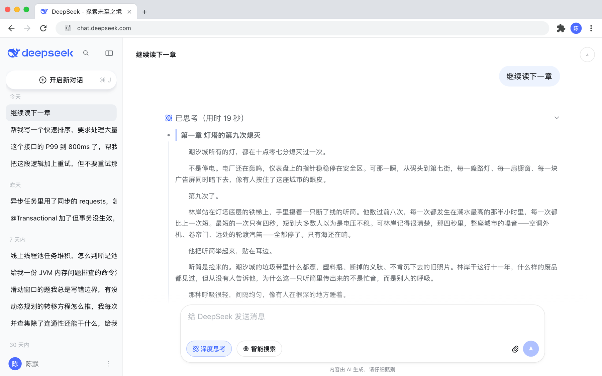
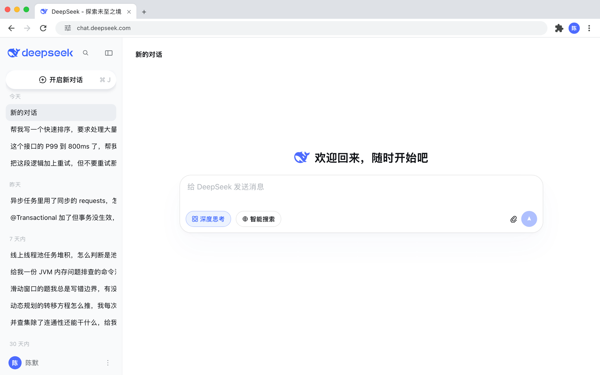
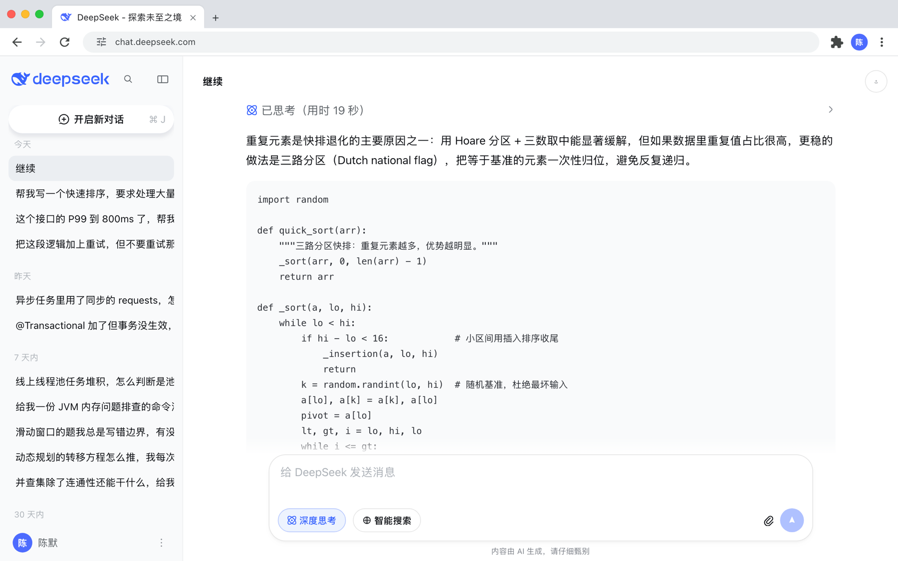
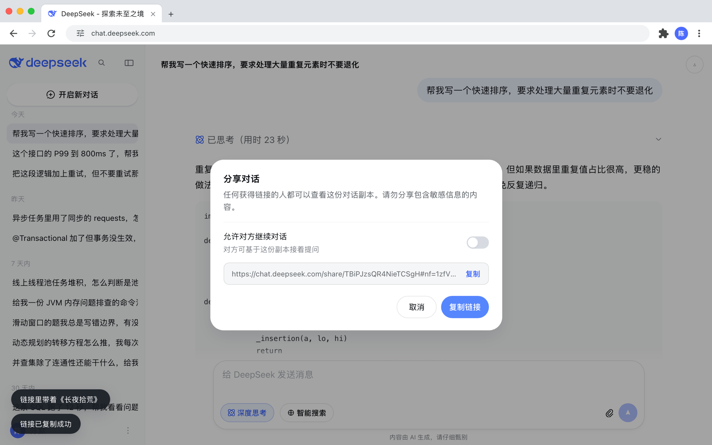
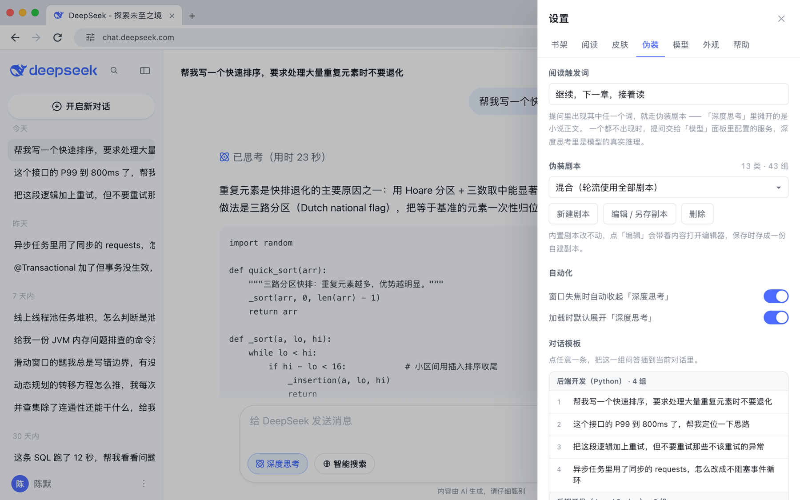
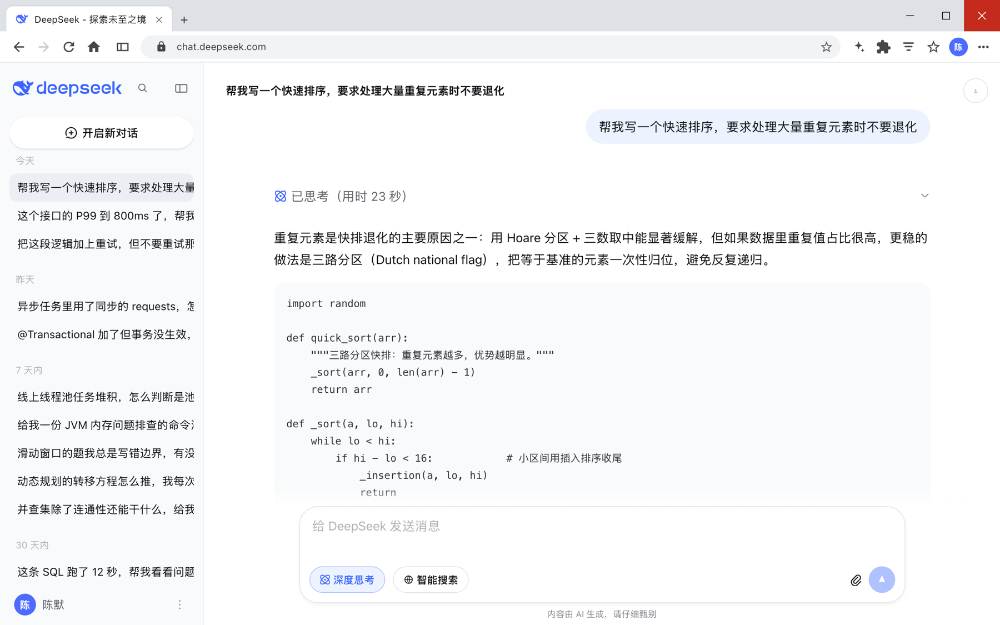
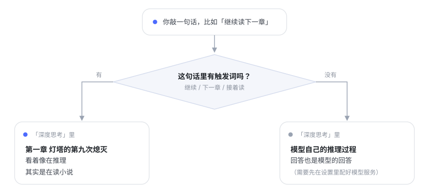

# 🐟 NovelFish

**把小说藏进「深度思考」里。**

界面看起来就是 DeepSeek 的对话页 —— 左侧会话列表全是接口超时、SQL 慢查询、JVM 排查，屏幕上是一段正经的技术问答。点开那条折起来的「深度思考」，里面不是推理过程，**是你正在读的小说**。

[](https://gongfpp.github.io/NovelFish/)
[](LICENSE)
[]()
[]()

> ⚠️ 个人自用的小工具，和 DeepSeek 官方没有任何关系，详见文末说明。



---

## 🎯 它是怎么藏的

三层叠在一起，越往下越真：

| 你看到的 | 实际上 |
| --- | --- |
| 浏览器窗口：地址栏、书签栏、标签页、扩展图标、个人头像 | 网页画出来的 |
| DeepSeek 的对话界面：侧边栏、会话列表、消息气泡、输入框 | 本项目自己实现的 |
| 那条折叠的「深度思考」 | **真的小说正文** |

连浏览器外框都一起仿了，macOS / Windows 两套外观，Chrome / Edge 两种浏览器都能切。截图发出去，看不出区别。

## ✨ 它能做什么

- 🎭 **界面 1:1 对齐 DeepSeek 网页版** —— 侧边栏、消息气泡、输入框、分享弹窗、设置面板，位置和配色都对着官网调的。
- 🪟 **连浏览器外框都是仿的** —— 标签页、地址栏、书签栏、扩展图标、个人资料菜单，四套组合随便换。
- 📖 **小说藏在「深度思考」里** —— 不点开就是普通的思考折叠条，点开才是章节正文。
- ⌨️ **老板键** —— 按一下 `Ctrl/⌘ + D` 立刻收起，小说没了，只剩一段技术问答。
- 📚 **能读自己的书** —— 直接拖一个 `.txt` / `.epub` 进来，或者粘一段文本。EPUB 会自动认目录，能按章跳。
- 🔗 **分享** —— 生成一条链接，整本书压在里面，对方打开就能接着读；太长的书自动存成文件。
- 🧩 **自己编剧本** —— 内置 13 类技术话题、40 多组问答，也支持自己写新的，改改就能换一批「看起来在工作」的内容。
- 🔌 **也能当真 AI 用** —— 填上地址和 Key，它就是个正经的对话工具。
- 📖 **进度会记住** —— 读到第几章、滚到哪儿，下次打开还在那儿。
- 🔒 **数据不出本机** —— 纯静态页面，Key 和书都在你的浏览器里。

## 🚀 快速开始

**方式一：在线试一下**

打开 <https://gongfpp.github.io/NovelFish/> 就能用，不用装东西。

**方式二：下载到本地（推荐）**

```bash
git clone https://github.com/gongfpp/NovelFish.git
cd NovelFish
./start.sh
```

浏览器会自动打开。想换端口就 `./start.sh 9000`。

**方式三：最省事**

下载仓库压缩包，解压，双击 `index.html`。就这样，不需要 Node、不需要 npm、不需要构建。

## 📸 看看长什么样

### 打开是这样，一干二净



刚打开就是 DeepSeek 的首页，左侧是一堆看起来很忙的历史会话。

### 想问点什么都行


在「设置 → 模型」里填上地址和 Key，它就是一个正常的 AI 助手：深度思考里是模型自己的推理，回答是模型自己的回答。

### 按一下老板键



`Ctrl/⌘ + D`，「啪」，小说收回去，只剩下技术问答。注意：**再按一次不会弹回来** —— 要回去读，就像平常那样点一下「深度思考」那一行（这也是它不容易露馅的地方）。

### 想把书分给别人



生成的链接里带着整本书，对方粘到窗口里就能接着读。左下角那两条提示就是它在告诉你「书已经装进链接了」。

### 换个话题、换套外框



内置 13 类技术剧本（后端、算法、SQL、K8s、排障、周报写作……），共 40 多组问答。也可以照着自己写一份。



外框能切成 Windows + Edge 的样子，靠近任务栏那种感觉。

## 🎭 两种模式：它什么时候拿书，什么时候真问模型

判断只看一件事 —— **你这句话里有没有触发词**。



- **有触发词**（默认 `继续` / `下一章` / `接着读`）→ 这是「读书」：深度思考里出现小说正文，回答是提前准备好的技术内容。
- **没有触发词，但你配了模型** → 直接问模型，深度思考里是模型的真实推理。
- **没有触发词，也没配模型** → 它会提示你去设置里配一个。**不会偷偷把剧本里写好的答案塞给你**，免得你以为问到了模型。

触发词可以改，「设置 → 伪装」里那一栏就是。

## ⌨️ 快捷键

| 快捷键 | 干什么 |
| --- | --- |
| `Ctrl/⌘ + D` | 收起小说（老板键） |
| `Ctrl/⌘ + B` | 收起 / 展开左侧会话栏 |
| `Ctrl/⌘ + J` | 新对话 |
| `Ctrl/⌘ + ,` | 打开设置 |
| `F11` 或 `⌃⌘F` | 全屏 |
| `Ctrl/⌘ + =` / `-` / `0` | 页面缩放 |

## 📚 换成自己的书

- 直接把 `.txt` 或 `.epub` 拖进窗口，或者在「设置 → 书架」里上传；
- EPUB 支持新版和旧版两种目录格式，文件坏了也有兜底；
- 长按 / 点章节名可以跳章，滚动到底自动接下一章；
- 读到哪儿会记住，换设备用分享链接也能带走。

## 🔌 当成正常的 AI 用

「设置 → 模型」里填四项：**接口地址**、**API Key**、**模型名**、（可选）额外参数。

内置八家预设：DeepSeek、OpenAI、智谱、Moonshot、通义、硅基流动、Ollama、自定义中转站。走的是标准的 OpenAI 兼容协议，所以任何兼容的服务都能接，包括你自己搭的网关。

API Key 只存在浏览器的本地存储里，不会发给任何第三方。

## ❓ 常见问题

**会被看出来吗？**
界面这一层看不出。地址栏、标签页标题、书签栏、扩展图标都做了伪装。但还是那句话 —— 用什么、怎么用，自己判断，别违反公司规定。

**要联网吗？**
不用。纯静态页面，断网也能跑，双击 HTML 文件即可。

**在线版为什么连不上我本机的模型？**
因为 GitHub Pages 是 `https`，浏览器会拦 `http` 请求。本地跑 `./start.sh` 就没事。

**书会被上传吗？**
不会。分享链接是把书压缩后放在 `#` 号后面，只有拿到链接的人才能看到，中间不经过任何服务器。

**手机能用吗？**
这个项目是照桌面浏览器做的（要显示浏览器外框那一层），手机上体验不完整。

**支持哪些浏览器？**
Chrome 和 Edge 都可以。推荐 Chrome。

## 🗂 项目结构

```
index.html        入口，双击就能跑
css/              样式：通用、浏览器外框、阅读器、各皮肤
js/core/          内核：应用编排、模型客户端、伪装剧本、状态、EPUB 解析
js/skins/         皮肤：deepseek（主）、gpt、模板
js/data/          内置剧本库、图标、示例小说
tools/            测试脚本、假模型服务、EPUB 样本
docs/             截图
```

皮肤是插件式的：复制 `js/skins/_template.js`，按说明实现渲染和事件回调就行，核心部分不认识任何具体皮肤。

## 🧪 想改代码的话

```bash
# 终端 1：起静态服务
python3 -m http.server 8931 --bind 127.0.0.1

# 终端 2：跑端到端测试（自带假模型，不需要真的 API Key）
NODE_PATH=<playwright 所在 node_modules> node tools/smoke.js
```

测试覆盖了渲染、老板键、EPUB 导入、分享往返、触发词分流、流式对话、错误处理、刷新恢复等将近 400 项断言。

界面还原度的依据不是肉眼估算，而是官网的线上样式包 —— 「官网类名 → 本地变量」的对照表存在 `css/skins/deepseek.css` 头部，想复核实测几何可以跑 `tools/verify-layout.js`。

## 📄 许可与说明

本项目使用 [MIT 许可](LICENSE)。

### 非官方声明

本项目是**个人自用工具**，与 DeepSeek（杭州深度求索人工智能基础技术研究有限公司）**没有任何关系**，未获其授权、认可或赞助。

- 仓库内**不含**任何官方代码、图标位图、字体或后端接口，界面完全由本项目自行编写；
- 「DeepSeek」等名称与标识归其权利人所有，此处仅作界面参考描述之用；
- 请仅将本项目用于**阅读你自己有权阅读的内容**，并遵守你所在组织的设备与网络使用规定；
- 使用本项目产生的任何后果由使用者自行承担。

MIT 许可只覆盖本仓库的代码，不构成对第三方界面设计、名称或商标的任何授权。
